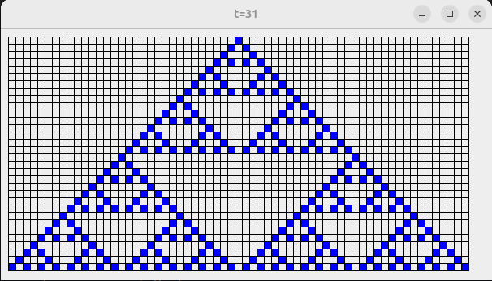

# Automates cellulaires N-dimensionnels

Simulateur d'automates cellulaires en Java pour des grilles de **dimension quelconque** (1D, 2D, 3D, …). Tout est décrit dans un fichier XML : taille de la grille, voisinages, règle d'évolution et état initial. Le **Jeu de la vie** et le **triangle de Sierpiński** sont de simples fichiers de configuration.

<!-- TODO : ajouter un GIF du planeur et une capture de Sierpiński -->

## Aperçu

| Planeur                      | Triangle de Sierpiński                             |
|---------------------------------------|----------------------------------------------------|
|  |  |
## Fonctionnalités

- Grille de dimension `d` choisie dans le fichier, construite par une structure récursive
- Voisinages prédéfinis (`G0`, `G2`, `G4`, `G6`, `G8`, `G26` et leurs variantes `G*` sans la cellule centrale) et voisinages personnalisés
- Règles écrites dans un petit langage : `ET`, `OU`, `NON`, `SUP`, `SUPEQ`, `EQ`, `COMPTER`, `ADD`, `SUB`, `MUL`, `SI`
- Initialisation par coordonnées ou aléatoire
- Interface graphique : grille 2D animée, générations empilées en 1D, coupe 2D en dimension 3 et plus
- Menu qui liste les fichiers `.xml` du répertoire courant

## Lancer le projet

Prérequis : JDK 11 ou supérieur.

```bash
javac -d out $(find src -name "*.java")
java -cp out automate.Main
```

À lancer depuis le dossier contenant les fichiers `.xml`.

## Exemple de configuration

```xml
<?xml version="1.0"?>
<automate>
    <dimensionGrille>2</dimensionGrille>
    <tailleGrille>
        <dimension>20</dimension>
        <dimension>20</dimension>
    </tailleGrille>
    <regle>SI(EQ(COMPTER(G0),1),
        SI(OU(EQ(COMPTER(G8*),2),EQ(COMPTER(G8*),3)),1,0),
        SI(EQ(COMPTER(G8*),3),1,0))</regle>
    <initialisation>
        <random>15</random>
    </initialisation>
</automate>
```

Voici ce que contient chaque balise :

- `initialisation` : `<random>k</random>` (k % de cellules allumées) ou une liste `<cellules><cellule>(x,y)</cellule>…`
- `coupe` : obligatoire en dimension 3 et plus, par exemple `(3,:,:)`
- `voisinages` : optionnel, pour définir des voisinages personnalisés (`<voisinage nom="G5"><coords><coord>(-2)</coord>…`)

## Fichiers fournis

| Fichier | Contenu |
|---|---|
| `jeu_de_la_vie.xml` | Jeu de la vie, grille 20×20, 15 % de cellules allumées |
| `sierpinski.xml` | triangle de Sierpiński en 1D (31 pas) |

## Organisation du code

| Package | Rôle |
|---|---|
| `tab` | grille N-dimensionnelle et interface graphique |
| `operateurs` | un opérateur par classe, formant un arbre d'évaluation |
| `voisinages` | voisinages prédéfinis et personnalisés |
| `parsing` | lecture du fichier XML et des règles |
| `automate` | moteur d'évolution et menu |

L'évolution est simultanée : la génération suivante est calculée dans une nouvelle grille, puis remplace l'ancienne. Les cellules hors de la grille sont considérées comme éteintes.
